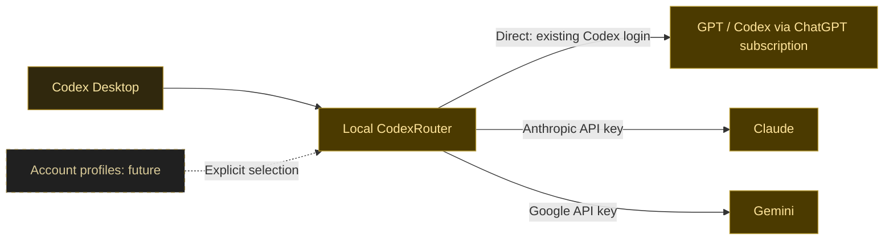

# CodexRouter

A local router for Codex that connects multiple model providers and lets you switch between subscription accounts.

**Status: design stage.** The routing service, provider adapters, and account switching are not implemented. There is no executable or installation procedure yet.

## Direction

Keep Codex Desktop as the client and use a local CodexRouter service to select a model provider and an authorized account. The first integration targets are the existing Codex subscription route, Claude through an Anthropic API key, and Gemini through a Google API key.

The diagram describes the intended architecture. Each route still needs compatibility testing with Codex Desktop.

## Detailed design

The [design overview](docs/design/README.md) defines the desktop connection, immutable routes, and delivery boundaries. [Provider protocol](docs/design/protocol.md) covers streaming, tools, and conversation state; [accounts](docs/design/accounts.md) defines credential ownership and explicit profile selection; [runtime and interfaces](docs/design/runtime-and-interfaces.md) compares languages and proposes CLI plus tray/settings control; [delivery and validation](docs/design/validation.md) records acceptance gates.

Claude and Gemini API adapters are required initial release targets. Managed ChatGPT subscription profiles follow as a separate milestone within this project, using independently authorized credentials. The existing desktop login and managed profiles have different authentication and continuity contracts.

## Design boundaries

| Concern | Intended responsibility |
| --- | --- |
| Codex integration | Accept requests through a supported Codex configuration and verify model selection, streaming, tool calls, cancellation, and conversation continuity. |
| Routing | Select the configured provider and account explicitly. Keep the destination visible and avoid silently switching providers or credentials. |
| Provider adapters | Translate each provider's request, response, streaming, and error semantics. Document unsupported capabilities. |
| Account profiles | Keep credentials separate from routing rules and isolate each account's state. Use the existing Codex login as the initial subscription path. |

Multiple subscription accounts belong in this project as a separate account-management concern. The intended first step is manual profile selection for a new conversation, with active conversations kept on their selected account. Switching the account used for model requests does not imply switching the entire desktop application's workspace, plugins, or cloud account.

Subscription credentials and provider API keys are distinct authentication methods. API routes use the corresponding provider's API credentials. Additional subscription integrations need their own authentication and compatibility validation.

Rust is selected for the daemon, CLI, and first connection experiment, with Tauri 2 and a TypeScript frontend for the tray/settings companion. Node/Electron, Python/Qt, and Go were evaluated; the [stack decision](docs/design/runtime-and-interfaces.md#stack-decision) records the tradeoffs and conditions for reconsideration. Runtime selection does not establish compatibility or packaged support. Storage format and credential integration still require qualification. Core/CLI and companion targets include Windows, macOS, and Linux; each requires independent validation. Automatic account rotation and quota-based failover are outside the initial scope.

## Repository workflow

- [AGENTS.md](AGENTS.md) defines development, validation, issue, and PR conventions.
- [CLAUDE.md](CLAUDE.md) imports the same instructions.
- [Issue forms](.github/ISSUE_TEMPLATE) cover bugs, changes, parent work, and questions.
- [The PR template](.github/pull_request_template.md) records scope, acceptance criteria, and validation.
- [The label catalog](.github/labels.json) defines the repository's labels.

All project content is written in English. Changes use feature branches and squash-merged pull requests. The current repository contains documentation and collaboration settings; it has no runtime dependencies, build commands, test suite, or CI workflows.
