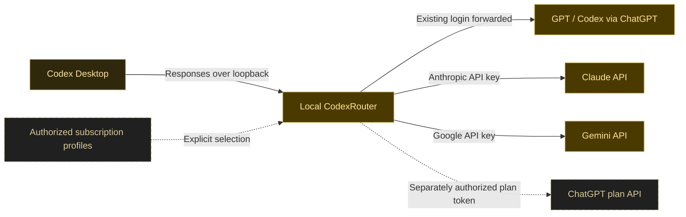
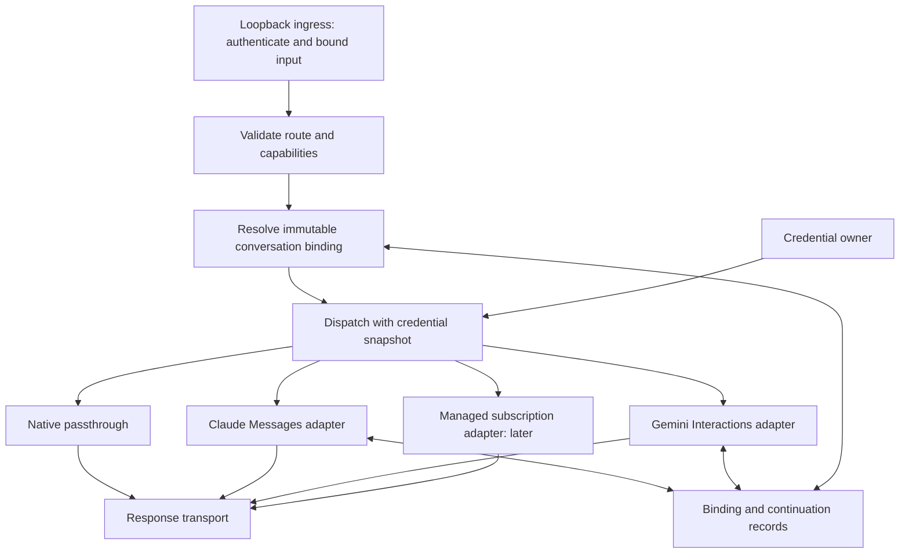

# CodexRouter design

Status: proposed design, 2026-10-13. No router, provider adapter, credential store, or account-switching feature is implemented. The compatibility gates below have not been run.

## Product outcome

Use Codex Desktop to choose between its existing ChatGPT subscription, Claude with an Anthropic API key, and Gemini with a Google API key. Claude and Gemini are required delivery targets. Add explicit selection between separately authorized ChatGPT subscription profiles within the same project.

The desktop remains the client and owns its tools, approvals, workspace, and conversation UI. CodexRouter owns inference routing, protocol translation, and the credentials explicitly entrusted to it. Changing an inference profile does not switch the desktop's cloud account, plugins, MCP connections, or other services.



Solid lines describe the initial target; dashed lines describe the later managed-profile milestone. Neither indicates implemented support.

## Document ownership

| Document | Owns |
| --- | --- |
| This document | Product scope, desktop connection, routing decisions, component boundaries |
| [Protocol](protocol.md) | Provider translation, stream and tool contracts, continuation, error semantics |
| [Accounts](accounts.md) | Credential ownership, profile selection, isolation, refresh, local security |
| [Runtime and interfaces](runtime-and-interfaces.md) | Language comparison, CLI, tray/settings UI, process lifecycle, platform targets |
| [Delivery and validation](validation.md) | Feasibility experiments, acceptance gates, release evidence, unresolved decisions |

These documents are the design source of truth. Issues should describe independently completable implementation outcomes and link to the applicable contract. A design change belongs in a reviewed documentation change; an issue does not silently override it. Create implementation issues when work is selected, rather than converting every possible future feature into a backlog.

## Evidence and decisions

| Statement | Status and consequence |
| --- | --- |
| Codex documents custom providers using the Responses protocol, SSE, and custom model catalogs | Documented. Use this integration boundary; verify the installed desktop and bundled client together. [Gateway compatibility](https://learn.chatgpt.com/docs/enterprise/gateway-compatibility) |
| Codex documents forwarding ChatGPT sign-in through a gateway using separate gateway authentication | Documented in managed deployment guidance. Applicability to a personal local desktop installation is an experiment, not a support claim. [ChatGPT gateway authentication](https://learn.chatgpt.com/docs/enterprise/sign-in-with-chatgpt-through-a-gateway) |
| User-level configuration can select a provider; project-local configuration cannot redirect its authentication destination | Documented. Never install routing settings in a repository's `.codex/config.toml`. [Advanced configuration](https://learn.chatgpt.com/docs/config-file/config-advanced) |
| Installed desktop code contains custom-provider and model-catalog paths | Static observation only. It does not establish picker visibility, account eligibility, quota behavior, or a working tool loop. |
| Claude and Gemini can satisfy the desktop's entire inference contract | Unverified. Both must pass the same release gates; expose only capabilities actually qualified. |
| Subscription profile selection can preserve active conversations | Proposed, subject to supported authentication and stable conversation identity. It must not be implemented as an uncoordinated global login-file replacement. |

## Scope and first deliverable

The first usable release must include the native subscription route and both API adapters, with visible route identity, text streaming, local function tools, the custom tools actually emitted by the qualified desktop, follow-up turns, ordinary compaction, cancellation, and useful failures. A text-only prototype is an experiment, not that release.

Windows, macOS, and Linux are core/CLI and companion targets; Windows Desktop is the first available live qualification target. Each OS needs its own packaging, credentials, and lifecycle checks, and Codex Desktop E2E depends on actual client availability. The desktop and bundled client versions, upstream model IDs, API versions, and enabled capabilities form a tested combination; a provider's marketing name alone is not a compatibility claim. See the [platform matrix](runtime-and-interfaces.md#platform-targets).

The initial design excludes automatic account rotation, quota-based fallback, remote multi-user hosting, a web management UI, third-party subscription login reuse, and arbitrary upstream URLs. Audio, video, hosted provider tools, background jobs, batches, and WebSocket transport are separate capabilities. An unsupported capability must be rejected clearly or disabled in the validated client catalog before the request is made.

## Desktop connection

### Two authentication modes

Both modes use the same process and adapters. They are installation choices, not credentials to mix in one provider block.

| Mode | Desktop-to-router authentication | Routes |
| --- | --- | --- |
| Native plus API | Codex-managed ChatGPT bearer plus a separate router token header | Native subscription, Claude API, Gemini API, and later managed subscription profiles |
| Router-managed | Router bearer token only | Claude API, Gemini API, and later separately authorized subscription profiles |

In native mode, desktop OpenAI credentials are forwarded only on the native route to the fixed official backend. API and managed-profile routes discard those credentials before constructing a new provider request. Router-managed mode has no native-forwarding route. A managed profile can coexist with native forwarding in the first mode, but uses its own authorization and upstream contract.

The following is a proposed experiment configuration, not an installation procedure. It uses placeholders and requires a generated, version-matched catalog. Applying it requires a separate integration task and a backup of the user's affected configuration.

```toml
model = "cr-claude-primary-r1"
model_provider = "codexrouter"
model_catalog_json = 'C:\absolute\path\to\codexrouter-models.json'
web_search = "disabled"

[model_providers.codexrouter]
name = "CodexRouter"
base_url = "http://127.0.0.1:15721/v1"
wire_api = "responses"
requires_openai_auth = true
env_http_headers = { "X-CodexRouter-Key" = "CODEXROUTER_LOCAL_TOKEN" }
supports_websockets = false
request_max_retries = 0
stream_max_retries = 0
```

For the router-managed experiment, remove `requires_openai_auth` and `env_http_headers`, then use `env_key = "CODEXROUTER_LOCAL_TOKEN"`. Do not put both credential mechanisms in the block. The desktop launch environment must receive the token; setting a terminal variable alone may not affect an already running app. Retrieve it from protected storage into the launched process environment; do not assume a persistent user environment variable is encrypted storage. Loopback HTTP acceptance, configuration precedence, and retry settings must be verified before distribution. [Provider configuration](https://learn.chatgpt.com/docs/enterprise/connect-to-a-gateway)

The daemon owns launching the qualified Codex executable with the token; CLI and companion request the same launch operation. A router-provided launcher/shortcut uses that operation on subsequent launches. Do not replace the original application shortcut silently or assume an existing single-instance desktop adopts a new environment: require a controlled restart when necessary. An ordinary OS launch without qualified token delivery remains unavailable and must have a clear launch/restore recovery path. M0 must qualify each advertised launch path, including relaunch after sign-out or reboot, and the [subprocess isolation policy](accounts.md#local-security-boundaries).

User-level settings can affect other clients sharing the same Codex home. The Windows desktop and native CLI share that directory by default. Preview the affected scope; CLI/IDE use through this installation requires separate client/version and token-delivery qualification. Otherwise it is unsupported while using those shared routing settings. Qualify a supported isolated configuration scope before promising unaffected coexistence; never copy login files to manufacture isolation. [Windows configuration sharing](https://learn.chatgpt.com/docs/windows/windows-app#share-config-auth-and-sessions-with-wsl)

The installer, when implemented, should preview the exact user-level changes and preserve unrelated settings. Catalog, configuration, environment, and process state cannot form one filesystem transaction. Stage and validate them in the order below, with atomic publication of each file and recovery records for interrupted steps. This design task does not apply any settings.

1. Record expected old values for owned keys: `model`, `model_provider`, `model_catalog_json`, the provider block, and any changed feature setting such as `web_search`. Record the owned token-delivery mechanism separately without recording its secret.
2. Stage the protected token and validated catalog, start the router, and verify readiness. Publish configuration only after these dependencies exist; restart the desktop with the required environment and verify the selected route.
3. On restore/uninstall, stop affected work and close the desktop, restore the prior model/provider and catalog reference together in one configuration write, and restore other owned settings and token delivery. Reopen and verify the prior connection before stopping the router and removing unreferenced generated files.

Restore only values that still match the installed generation; conflicting user edits require reconciliation. Rotating the local token requires a coordinated router/desktop restart and verified replacement, not a live unilateral change. Preserve old provider definitions and conversation records. Activation initially applies to new conversations. Existing conversations can carry a persisted provider identity and may resume outside the new route or be filtered differently; migration requires separate evidence and must not rewrite history behind the user's back.

Every router-owned settings change, including new-chat route selection, preserves the original pre-install values and advances the expected current owned values. Compare the actual file's owned keys immediately before writing, not just the daemon's in-memory revision. Stage recovery metadata for interrupted configuration/ownership-record publication; two files are not an atomic transaction. On uncertain recovery, reconcile instead of overwriting external edits.

Qualify whether the desktop picker persists `model`. If it does, recognize a picker transition only through a qualified signal and an exact alias owned by this installation, with the other owned values unchanged; then advance the expected selection without changing the pre-install value. A `cr-` prefix alone proves no ownership or user intent. Unknown edits require explicit reconciliation. Restore publishes a coherent model/provider/catalog set only after reconciliation; uninstall must not remove the daemon or catalog while unresolved settings still reference them.

The example disables web search globally for the initial experiment, including native requests. Native transport transparency is not a promise of unchanged client feature configuration. When the router is unavailable, every route configured through it is unavailable; do not bypass it or fall back to another provider. A local recovery command must restore the prior owned configuration without requiring a healthy daemon.

### Endpoints and catalog

| Surface | Contract |
| --- | --- |
| `POST /v1/responses` | Authenticated inference. Route selection and full request validation precede any upstream request. |
| `GET /v1/models` | Authenticated client-specific model catalog. Verify the exact path, query parameters, and schema the target desktop uses. |
| Native upstream | Fixed Codex backend; preserve native Responses semantics and required headers. Qualify any additional endpoint, such as compaction, separately. |
| Local administration | Same-user local CLI/IPC. No administrative HTTP endpoint in the initial design. |

The native Codex catalog uses a top-level `models` array; a generic OpenAI model list is not interchangeable. A configured custom catalog replaces the bundled catalog, so it must include every selectable native and external route. Its metadata must describe the actual adapter's context budget, reasoning options, and tools. Owned aliases have no automatic model migration (`upgrade: null`). Restart behavior and stale catalog recovery are acceptance cases. [Catalog configuration](https://learn.chatgpt.com/docs/enterprise/roll-out-a-gateway)

One validated route snapshot generates both the static catalog and any qualified discovery response. They are views of the same generation, not independently editable authorities. Keep aliases referenced by retained bindings resolvable in the catalog. A replaced key's old alias remains usable while its profile is valid; a disabled/removed profile retains an unavailable entry and actionable failure. Hide it from new selection only if the client supports that distinction; otherwise label it unavailable. Qualify old-chat reopen in both cases and block publication if the client silently substitutes a model. Expiry may remove catalog entries, but never reassign their aliases.

Record the desktop/bundled-client version in catalog-generation metadata. An unqualified version mismatch reports `compatibility_update_required` and blocks new work on the generated catalog's routes, including native passthrough; in-flight requests retain their admitted snapshot. CLI/UI shows `Compatibility update required` and offers installation of a qualified catalog/router combination or restoration of the prior owned Codex connection. Restoration is explicit and verified, never a silent bypass. Existing router-bound conversations remain unavailable until their route is qualified; restoring the old connection does not migrate their history.

M0 must identify the running client/version through a qualified request signal or a verified launch-session association. An install-time file version alone cannot identify a still-running or newly updated client. Bind admission to the qualified client/catalog combination and invalidate the association on restart/update; unknown identity/version blocks activation or new work. If neither mechanism works, this gate fails rather than claiming automatic version detection. Desktop updates can therefore require a router qualification update or explicit restore before work resumes.

Use truthful, immutable aliases such as `cr-claude-primary-r1` and `cr-gemini-primary-r1`. Display the provider, actual upstream model, credential kind, and a user-chosen profile label. Do not expose account IDs or email addresses in aliases. An alias binds one provider, upstream model version, profile reference, and capability revision. Changing that tuple creates a new alias; an old alias remains bound or becomes unavailable. Never disguise an external model as a native model to bypass a picker restriction.

If the desktop cannot show/select the aliases, applies an incompatible native quota gate, or silently substitutes a model before calling the router, the integration gate fails. First investigate supported configuration and catalog metadata. Do not patch application binaries or declare success from a CLI-only request.

## Internal responsibilities



These are responsibilities within one local process, not a requirement for separate packages or services.

| Responsibility | Input and result |
| --- | --- |
| Ingress | Authenticates the local client, checks Host/Origin, bounds payloads, associates cancellation with the request |
| Route resolver | Resolves a catalog alias into an immutable route snapshot; rejects unknown, removed, or mismatched revisions |
| Capability validator | Checks all content, tools, reasoning options, and transport requirements before contacting a provider |
| Conversation binding | Enforces the selected route/profile and continuation lineage; rejects an ambiguous resume |
| Provider adapter | Encodes native input, decodes events, preserves opaque continuation data, and returns normalized outcomes |
| Credential owner | Supplies a short-lived credential snapshot for exactly one identity/destination; owns refresh only for managed profiles |
| Response transport | Emits bounded incremental SSE, handles backpressure and disconnects, and releases resources |

Do not build a universal model SDK. Shared code should cover observable invariants such as identifiers, error categories, cancellation, and state commits. Native signed content stays provider-specific rather than being flattened into a common text transcript.

## Routing and continuity

Resolve the destination once per admitted request. A conversation binding includes local client identity, stable conversation key, alias revision, credential profile ID, provider API/model revision, and continuation epoch. Credential refresh updates the secret generation within the same identity; it does not change this binding.

The integration experiment must identify a reliable conversation key on actual desktop requests, including reopen, fork, compaction, and concurrent conversations. Do not infer identity from prompt text or treat `previous_response_id` as the only identity when the client replays full history. Lookup uses the authenticated local installation identity plus the verified per-thread key, then the recorded item/call lineage within that binding. Local token rotation preserves installation identity rather than creating a new client identity.

A documented, qualified opaque extension that the client round-trips is an alternative only if it can preserve fork isolation and carry a router-authenticated, route-bound handle. Do not assume arbitrary fields survive or disguise such a handle as OpenAI-owned encrypted reasoning. If neither a per-thread key nor a valid handle works, M0 is a no-go for the required stateful adapters and profile switching. Stop delivery and revise the integration design; aliases alone are not an acceptable substitute. This is a deliberate feasibility gate, not a promised fallback.

A tree-root session ID can be shared by forked threads. Qualify a per-thread key rather than assuming a session or request identifier has the same meaning. Forks must receive separate bindings and cannot inherit another profile merely because they share a root session. [Thread identity](https://learn.chatgpt.com/docs/app-server#start-or-resume-a-thread)

The router has no mutable default account or floating route alias. Selecting a new default means selecting an existing immutable alias in the desktop or updating the user-level `model` setting for a restart. Existing conversations retain their binding; a changed alias with old history is rejected as a binding conflict. Selecting a different provider, model, or account inside one requires an explicit new conversation. Initial releases do not copy history across that boundary. A later context-transfer feature must display the destination and transferred content, exclude provider-owned signed state, and describe the result as a new conversation.

Native forwarding retains Codex ownership of login and refresh. It cannot pin a credential it does not own merely by retaining a bearer token. Detecting a native identity change and deciding whether to allow a resume is a separate acceptance gate in [Accounts](accounts.md); the managed-profile guarantee must not be attributed to native passthrough prematurely.

## Runtime and storage decisions

Select Rust for the bounded experiment and standalone daemon/CLI, with Tauri 2 and a TypeScript frontend for the companion. Native credentials, IPC, independent process ownership, and the small control UI drive this choice; no performance superiority is assumed. Node/Electron, Python/Qt, and Go remain evaluated alternatives rather than parallel implementations. [Runtime and interfaces](runtime-and-interfaces.md) records concrete implementation elements, qualification gates, and conditions for reopening the decision.

The design needs three logical records: nonsecret route configuration, credential references, and sensitive conversation continuation. It does not yet choose a database or filesystem schema. Each proposed persistent field must have a consumer and a recovery rule. The required stateful-adapter restart/resume contract makes protected durable continuation mandatory unless a qualified client-carried state mechanism fully replaces it. Do not persist prompts merely for convenient diagnostics.

The next implementation task is the bounded Rust feasibility experiment in [Delivery and validation](validation.md). Record its results before choosing physical storage, claiming supported desktop/platform versions, or publishing an installation procedure. A failed integration gate can stop the product direction even though its implementation language has been selected.
