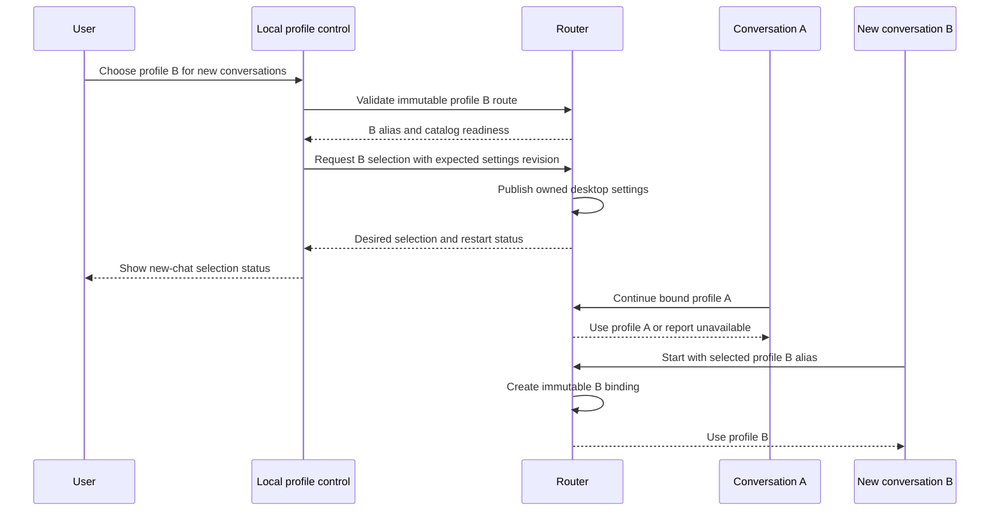

# Accounts, credentials, and local trust

Status: proposed. Account management belongs in CodexRouter, with a separate responsibility from routing and protocol translation. See the [overview](README.md) and [protocol](protocol.md).

## Credential ownership

| Credential | Owner | Allowed use |
| --- | --- | --- |
| Existing Codex ChatGPT login | Codex | Forward on the native subscription route; Codex owns login, refresh, and logout |
| Anthropic API key | User, stored by the selected router secret facility | Claude API only |
| Google API key | User, stored by the selected router secret facility | Gemini API only |
| Router local token | CodexRouter | Authenticate the desktop to the loopback listener; never forward upstream |
| Future subscription profile authorization | CodexRouter through a supported user-consent flow | Approved plan API and account identity only |

API access and subscription access are distinct. A Claude or Gemini consumer subscription does not supply the API credentials described here. Multiple ChatGPT profiles mean separately authorized accounts whose inference identity is visible; they do not grant access beyond each account's entitlement.

Do not read, clone, periodically replace, or compete to refresh Codex's credential files. Native passthrough forwards the current credential only for the lifetime of the request and never persists it. A router-owned profile must have its own authorization lifecycle; importing a refresh token also used by another process creates conflicting ownership and is not part of this design.

## Native login versus managed profiles

Native forwarding preserves the login managed by the desktop. The router cannot promise account-pinned resume just because an alias points to that route: Codex can refresh, log out, or change account independently. Qualify a supported, trustworthy identity signal before enforcing an account binding. A workspace/account header alone may not distinguish users; a hash of the changing access token is not a stable identity; unverified JWT claims are not an authenticated identity.

The native route uses a fixed `desktop-login` credential-source reference, not a managed account profile. Until a trustworthy identity signal is qualified, follow-ups transparently use the current credential supplied by Codex and have no router account-affinity guarantee. Label this route as using the current Codex login; only separately managed profiles promise account pinning. Once identity verification is enabled, a detected mismatch blocks resume. Keep router account switching unavailable for native forwarding and never retain a stale desktop token to imitate the previous login.

The managed-profile milestone should use the official application authorization flow where available, with explicit browser consent, isolated profile storage, and one refresh owner. This must be qualified separately from the native Codex backend. Changing only the upstream inference account does not change the desktop's own account or workspace.

Official guidance describes ChatGPT plan authorization for open-source and local applications through dynamic public-client registration. Each saved account/workspace registration has its own issued client ID and token set. Bind a profile to the verified issuer, subject, issued client ID, and returned authorization context; email and an installation host ID are not identity keys. Verify the required direct-inference permission. Eligibility and workspace policy remain runtime prerequisites. [Application sign-in](https://developers.openai.com/siwc/token-sharing-open-source/sign-in), [Saved accounts and sessions](https://developers.openai.com/siwc/token-sharing-open-source/profiles-and-sessions)

That grant is for `https://api.openai.com/v1/responses`, not the native ChatGPT backend. Fetch eligible models using the same selected account credential, preserve the upstream slug in its route mapping, and do not treat a bundled desktop catalog as proof of entitlement. The plan API has a narrower request contract, so managed profiles require their own adapter and capability revision. [Models and inference](https://developers.openai.com/siwc/token-sharing-open-source/models-and-inference)

## Profile model

Keep nonsecret metadata separate from secret values:

| Field | Purpose |
| --- | --- |
| Profile ID | Random stable local identifier; not an email or provider account ID |
| Display label | User-chosen name shown alongside the provider and credential kind |
| Credential kind | API key, native forwarding, or managed subscription authorization |
| Secret reference | Reference to OS-protected material, never the secret in route configuration |
| Validated principal | Account/workspace/authorization context when required, protected as sensitive data |
| Generation | Compare-and-swap version for refresh, revocation, and in-flight snapshots |
| State | Ready, refreshing, reauthorization required, disabled, or removed |

Provider entitlement and rate-limit observations are transient request outcomes, not alternative account identities. A successful model-list request does not establish entitlement to execute that model. Health and usage must never trigger account rotation by default.

Deleting a profile blocks new requests immediately. Existing binding references become unavailable rather than resolving to another profile. A revoked profile's in-flight requests are cancelled where possible, and its queued requests fail. Do not silently reuse a deleted profile ID or alias for a new account.

`Disabled` is the non-admitting intermediate state of removal, before local cleanup and the removed record are committed. Interrupted cleanup stays disabled and can be resumed; it cannot refresh back to ready. A separate reversible enable/disable feature is not part of the initial control contract.

## Explicit selection and conversation affinity

Use the Codex model selector with truthful route/profile labels where supported, a CLI, and a planned tray/settings companion for enrollment, selection, status, and recovery. Both control clients use the same daemon-owned operations. [Runtime and interfaces](runtime-and-interfaces.md) defines their lifecycle and the difference between desired and applied selection. No commands or UI are implemented yet.

Selecting a route for a new conversation binds that conversation to its immutable alias/profile revision. There is no router-side default to resolve during inference. Selection changes the desktop's chosen alias or its user-level `model` setting for a restart. No quota exhaustion, retry, daemon restart, or catalog refresh can substitute another profile. API keys do not necessarily expose a verifiable principal, so every API-key replacement creates a new profile and alias revision. Managed OAuth renewal advances only the generation after verifying the same registered identity.

Replacing an API key therefore creates a new-conversation boundary and requires updated aliases/catalog metadata, with a desktop restart when necessary. Existing conversations retain the old profile while it is still valid; if it is revoked or removed, those conversations cannot silently continue with the replacement. Display this consequence before the replacement action.

A new profile also needs its own aliases and a newly validated catalog. Publish the catalog before selecting an alias and restart the desktop when it loads catalog metadata only at startup. Do not claim a live desktop account picker unless the client exposes it. If the selected desktop cannot preserve a route across reopen or sends no usable conversation identity, managed switching remains blocked rather than falling back to global auth-file swapping.

A future request to change the account of an existing conversation creates a new conversation after explicit context-transfer approval. Do not resend previous conversation content to a newly selected account just to test whether it works. Signed reasoning, provider response IDs, tool-call identity, and entitlement state are never transferable by default.

## Refresh and lifecycle

Only the owner refreshes a credential. Managed profiles use one in-flight refresh per profile and an atomic generation update. Before commit, confirm the returned identity matches the enrolled principal and the profile has not been disabled, removed, or revoked. A failed refresh retains the last known state without overwriting another successful generation. A rejected refresh token changes the profile to reauthorization required; it does not fall through to another account.

Admitted requests capture the profile identity and credential generation. A same-identity refresh can supply a newer valid access token before dispatch; an in-flight request cannot change identity. Reserve admission per binding as defined in [Protocol](protocol.md#native-history-and-reasoning-state), while different bindings remain concurrent. Profile removal and new-chat route selection use the documented versioned metadata/publication transitions; do not expose partially updated state.

OAuth enrollment needs provider-approved client registration, requested scopes and audience, fresh PKCE/state/nonce, a loopback callback bound to the enrollment attempt, and explicit account selection. Validate the ID token signature, issuer, audience, expiry, and nonce. Use the returned issued client ID for its own token exchange and subsequent authorization; never combine registrations. Abort or mismatched callbacks leave no ready profile. Store returned tokens only after validation and successful protected persistence. Refresh must be crash-safe under rotating-token behavior, with reauthorization as the recovery when safe recovery cannot be proven. Installed-client compatibility and account eligibility remain feasibility gates.

Create and persist the installation's required host ID before first enrollment and reuse it across sign-in, sign-out, refresh, and account selection. Use the documented HTTP callback on `127.0.0.1`; keep scheme, host, and path unchanged across returning authorizations. The port may vary between attempts, but authorization and code exchange within one attempt use the exact same URI. `localhost` is not an interchangeable callback host.

## Local security boundaries

The process serves the signed-in operating-system user on loopback only. It is not a multi-user gateway. Protect against browser-origin requests, accidental exposure, cross-route credential leakage, and stale identity reuse. Malware already executing as that same user is outside the initial isolation guarantee; avoid claiming that loopback authentication provides sandboxing against it.

The local token authenticates the client, not the listening server. On a shared machine, another OS user may bind a stopped router's TCP port. Both modes could disclose the local token and request content or receive attacker-supplied model/tool output; native mode additionally exposes the forwarded ChatGPT bearer. Both modes require qualified server authentication or OS-isolated transport before deployment among mutually untrusted local users. A readiness check alone is not proof against this race.

On suspected endpoint takeover or unexpected listener ownership, stop affected connections and verify the endpoint before restarting. Invalidate the local token and provision a new one through the coordinated restart process; never reuse the possibly disclosed token as proof of server identity. Keep the stable installation/binding identity separate from that secret. Any exposed upstream credential remains subject to its owner's revocation/recovery flow. An ordinary outage without evidence of changed ownership reports unavailable and does not itself rotate profiles or credentials.

| Boundary | Required control |
| --- | --- |
| Network listener | Bind explicit loopback addresses; never wildcard. Validate Host and reject unexpected browser Origins. Require a high-entropy local token on inference and catalog requests. |
| Local administration | Same-user CLI/IPC with OS permissions; no unauthenticated health/details endpoint or browser dashboard containing secrets |
| Upstream destinations | Fixed per-provider HTTPS host/path allowlist; TLS verification on; reject redirects that could forward credentials |
| Header construction | Build provider requests from an allowlist. Remove local token, cookies, forwarded/auth headers, and credentials for all other providers. |
| Native forwarding | Permit only qualified Codex headers and methods to the fixed backend. Forward the selected native credential without storing it. |
| Secrets and state | OS-backed protection plus private file permissions; atomic writes, restrictive backups, versioned recovery |
| Observability | Request IDs, route labels, duration, status, and reported usage only by default; no payloads, tokens, account IDs, tool content, or opaque signatures |

Do not fetch arbitrary remote input URLs on behalf of the client. Unsupported image/file URL forms are rejected until a separate bounded retrieval policy is qualified; otherwise the router becomes a local-network request proxy. Authentication failures should not enumerate configured account labels or upstream secrets.

A process token must not be stored in tracked examples, command-line arguments, URLs, or raw diagnostics. Keep API keys and OAuth material out of TOML route data, exports, review artifacts, and crash reports. Use placeholders in examples. A future support bundle is opt-in, redacted, and excludes sensitive continuation storage by default.

Token delivery to Codex must not unnecessarily deliver the router credential to model-invoked shells, MCP servers, hooks, or other child processes. Qualify explicit environment exclusions and each child-launch path; a variable name containing `TOKEN` is not a sufficient guarantee. Configuration layers or explicit environment values can change the effective policy, and MCP environment forwarding is a separate surface. Treat required policy edits as owned installation settings and test exclusion with a synthetic marker, never by printing a real token. If the intended client setup cannot keep the token out of those environments, reject that delivery configuration. This limits accidental inheritance; it does not isolate arbitrary same-user code from the parent process or OS credential facility. [Shell environment policy](https://learn.chatgpt.com/docs/config-file/config-advanced#shell-environment-policy), [MCP environment forwarding](https://learn.chatgpt.com/docs/extend/mcp#stdio-servers)

## Persistence and recovery

Route configuration and credential records have separate versions and lifecycles. A configuration reload validates the complete new snapshot before publishing it. Invalid edits leave the last valid generation active and report the error locally. Retired aliases remain non-reassignable; resuming a removed route produces an actionable error.

Sensitive continuation records require the same protection as tokens because they can contain prompts, tool results, and reusable opaque state. Expiry, disk-full, key-unavailable, corrupt records, permission changes, and interrupted writes are first-class recovery cases. Never recreate missing state from an unrelated conversation or fall back to plaintext storage.

Use the OS credential facility for compact encryption key material; keep larger sensitive state under authenticated encryption with binding/generation integrity and private permissions. Native credential entries are not a transcript store: Windows generic credential blobs, for example, have a 2,560-byte limit. This selects a protection boundary, not a database, one-file-per-record layout, cipher library, or key hierarchy. Choose those from measured state/update needs. The selected Rust credential backend must work without Tauri; do not assume a generic keyring dependency guarantees an unlocked persistent store on every OS. [Windows credential storage](https://learn.microsoft.com/en-us/windows/win32/api/wincred/ns-wincred-credentialw), [Rust credential-store guidance](https://docs.rs/keyring/latest/keyring/)

When a secret facility is unavailable, fail closed with a setup/recovery message. A degraded storage mode must be an explicit future design decision, not an automatic fallback. Removal should clear local secrets and continuation references and attempt provider revocation when the supported flow offers it; local deletion alone cannot promise remote revocation.

The initial Linux credential integration targets an available, unlocked Secret Service with persistent protected storage. A session-only store that loses the encryption key on logout or reboot cannot satisfy continuation recovery. Qualify persistence across those boundaries, and do not silently select an ephemeral or plaintext backend to make headless startup succeed. An alternative protected facility requires the same explicit persistence and recovery evidence.
