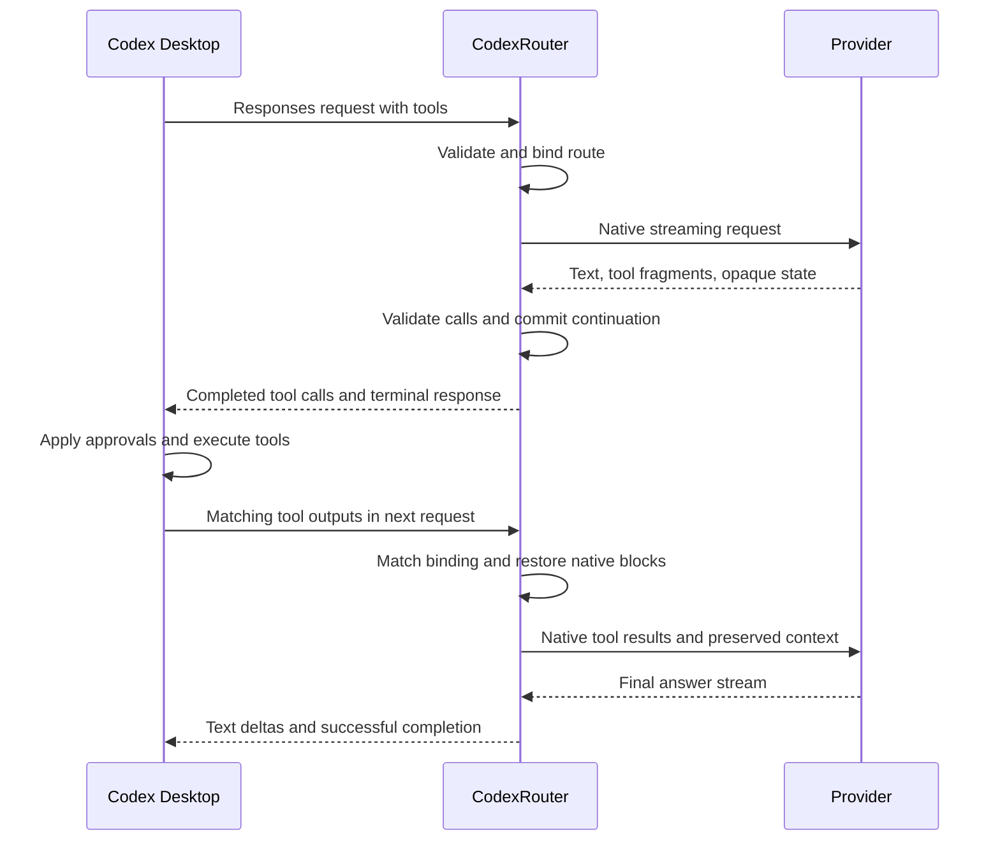
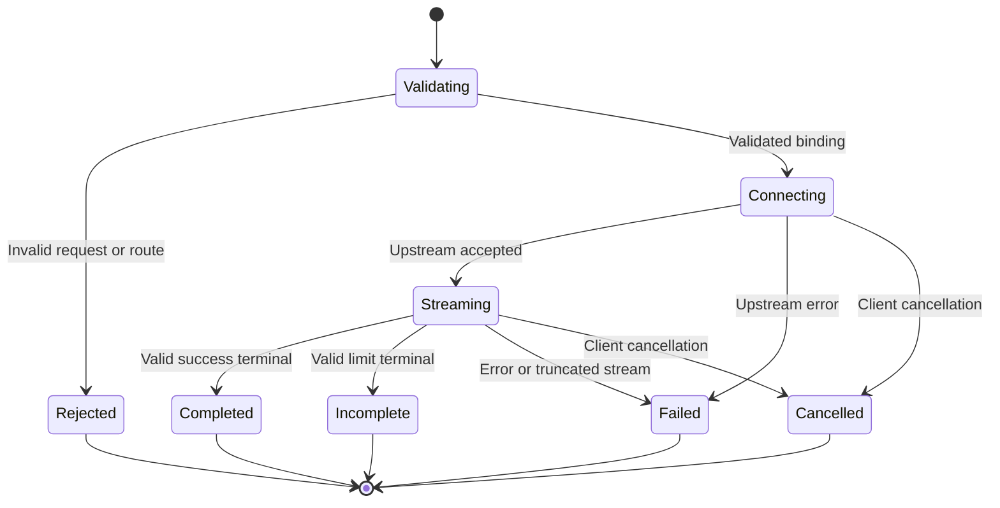

# Provider and conversation protocol

Status: proposed. This specifies required behavior; it is not an implemented compatibility claim. See the [design overview](README.md) for routing and the [validation gates](validation.md) for qualification.

## Provider contracts

| Route | Initial upstream contract | Credential and continuation |
| --- | --- | --- |
| Native subscription | Codex backend Responses, transparent semantic forwarding | Desktop-owned ChatGPT token; provider-owned native response state |
| Claude API | Anthropic Messages with streaming | Anthropic API key; complete native assistant blocks preserved for tool-result turns |
| Gemini API | Gemini Interactions, streaming, foreground, `store=false` | Google API key; explicit native step history, including thought/function-call steps |
| Managed subscription | Plan-authorized Responses API, later milestone | Router-owned authorization; model and entitlement qualification separate from native backend |

The Gemini choice follows the current Interactions contract. Confirm the exact API version and streaming schema in the spike; do not quietly switch transports when an example fails. Disable automatic server storage explicitly. Stateless operation cannot rely on `previous_interaction_id`; repeat request-scoped instructions, tools, and generation settings. [Interactions overview](https://ai.google.dev/gemini-api/docs/interactions-overview)

The selected native endpoints are Anthropic `POST https://api.anthropic.com/v1/messages` and Google `POST https://generativelanguage.googleapis.com/v1beta/interactions`. Gemini requests explicitly select `stream=true`, `store=false`, and `background=false`. These settings disable stored Interaction resources, not all provider retention; feature-specific and abuse-monitoring policies remain separate. [Gemini data policy](https://ai.google.dev/gemini-api/docs/zdr), [Claude retention](https://platform.claude.com/docs/en/manage-claude/api-and-data-retention)

The later managed subscription HTTP route requires `stream=true`, `store=false`, and replayed input; it does not support HTTP `previous_response_id`. It also restricts system-role items, generation options, and tool representation. Inventory actual desktop fields and use explicit semantics-preserving translations or reject unsupported requests. Do not pass native backend bodies through unchanged or silently discard unsupported options. [Plan API constraints](https://developers.openai.com/siwc/token-sharing-open-source/preview-limitations)

Claude requests need a pinned API version and explicit feature headers where required. Qualification records must include those values and the actual model ID. Unknown optional metadata may be ignored only when it cannot alter output, tool execution, completion, or continuity. Unknown content or behavior-affecting fields fail validation.

## Capability contract

Each alias has an explicit capability revision. Validation uses the same revision as the client catalog and adapter. The following is the required initial API-route scope, not a statement that it currently works.

| Capability | Required behavior |
| --- | --- |
| Text and instructions | Preserve role precedence, message order, Unicode, and multipart text boundaries relevant to replay |
| SSE text | Incremental delivery and a correct terminal outcome |
| Function tools | Names, schema, selection constraints, call IDs, arguments, results, and repeated tool turns |
| Parallel calls | Preserve the provider's complete call group and match every result; reject an unsupported requested constraint |
| Custom tools used by Codex | Explicitly emulated through a reversible string envelope, with format validation; block release if a required tool cannot be represented |
| Reasoning controls | Advertise only qualified options; maintain opaque signed continuation even if visible reasoning is disabled |
| Conversation continuation | Follow-up, complete tool replay, restart/resume, and a defined compaction boundary |
| Usage | Preserve provider-reported units and distinguish unknown counters from zero |
| Images | Separately qualified per route; disable in the initial catalog until payload and continuation tests pass |
| Provider-hosted tools, audio/video, background/batch, WebSockets | Unsupported initially; do not silently drop or substitute them |

Capability status values are `native`, `emulated`, `unsupported`, and `unverified`. Emulation must describe its observable difference. Required launch features cannot remain `unverified`. Accepting a JSON field alone is not support.

Requests must be checked as a whole before sending: input items, tool schemas, tool choice, parallel-call constraints, token budgets, reasoning options, output formats, storage flags, and continuation. Unknown or unsupported required behavior returns a client error identifying the field without quoting private content. Do not silently loosen strict schemas or discard an unsupported tool. Upstream context accounting uses the selected provider's budget; a GPT token estimate is not proof that another provider will accept a prompt.

Instruction conversion is a versioned emulation contract. Initial system/developer items may become ordered, explicitly role-delimited native instruction blocks only after hierarchy-conflict cases qualify that mapping. Do not silently hoist a mid-history instruction into the initial prefix. Inventory the desktop's actual dynamic instructions; either qualify a same-route epoch transition for them or reject the affected request. A required coding workflow that cannot survive these instructions blocks release. Changing the mapping changes the capability revision and native prefix.

Forced tool choice can differ by model even within one provider. Qualify each model's allowed choices and thinking configuration instead of applying a provider-wide boolean. Disable provider/SDK automatic model fallback as well as router fallback; one selected alias must not silently become another serving model. [Claude tool definitions](https://platform.claude.com/docs/en/agents-and-tools/tool-use/define-tools), [Provider fallback behavior](https://platform.claude.com/docs/en/build-with-claude/refusals-and-fallback)

## Identifiers and tool translation

Keep these identities distinct:

| Identifier | Meaning |
| --- | --- |
| Local request ID | One admitted transport attempt; safe for diagnostics |
| Response ID | One Responses result, scoped to the local client and binding |
| Output item ID and index | Stable identity and ordering within that result |
| Call ID | The pair between a tool invocation and its result |
| Native provider ID | Provider-owned message, step, call, or interaction identifier |
| Continuation epoch | A compatible native history lineage under one bound route |

Maintain a reversible mapping for names that exceed provider limits; detect collisions before sending. Store the mapping with the binding so later tool results are not interpreted under a new mapping. Never rewrite a tool result into an ordinary user message or merge distinct calls because their names match.

A custom freeform tool can use a provider function carrying one string value. Preserve exact newlines, quoting, and non-ASCII content when restoring the original input. Function JSON does not enforce the original custom-tool grammar. Only advertise a supported format when its validator exists; reject malformed output before emitting a completed executable call. No arbitrary grammar interpreter is required for initial scope: qualify the exact formats used by the target desktop and reject the remainder.

Codex continues to execute tools and apply approvals. CodexRouter does not execute shell commands, patches, MCP calls, or provider-requested local actions. Buffer argument fragments until a call is valid and the provider turn's required continuation state is safely retained. Partial argument deltas may be displayed only if the target client proves they cannot trigger execution; otherwise buffer that tool's output while text remains streamed.

While buffering a long call, use a client-qualified non-executable progress event or SSE keepalive. Verify that it resets the actual client idle timer; do not assume an SSE comment does. Record the configured idle limit and test a call longer than that limit. No heartbeat may claim a tool is complete or successful before validation.

For parallel tools, preserve all calls before their result group when required by the provider. Results arriving out of order are matched by call ID; missing, duplicate, orphaned, or conflicting results fail clearly. Preserve tool error results as errors with their original association.

## SSE lifecycle

Use an explicit response state machine rather than deriving completion from a closed socket.

For translated routes, emit stable response/item IDs, monotonic event sequence numbers, and indexes consistent with the final response snapshot. The event families include response creation/progress, output-item/content-part addition, text or tool-input deltas, item completion, and one terminal result. Pin the exact schema against the target client and Responses specification in fixtures before implementation is qualified. `Completed` means a valid protocol turn, which can contain text, a tool handoff, or a typed refusal; it does not always mean a final natural-language answer.

| Provider outcome | Responses outcome |
| --- | --- |
| Claude `end_turn` / `stop_sequence`; Gemini completed answer | `response.completed` with completed message items |
| Claude `tool_use`; Gemini `requires_action` | `response.completed` with validated call items and retained continuation; Codex can execute tools |
| Explicit refusal with a representable refusal item | Completed turn with typed refusal content, never an invented tool call |
| Claude `max_tokens`; Gemini token-limit incompletion | `response.incomplete` with the qualified incomplete reason; truncated calls are not executable |
| Context-window exhaustion | Client-recognized context-limit failure; do not fabricate a token-limit reason when it means something else |
| Safety/content filtering | Qualified refusal or `response.incomplete` content-filter mapping, preserving the distinction from a provider failure |
| Claude `pause_turn` for unsupported server-tool continuation | Unsupported-operation failure; no hidden continuation loop |
| Provider error, malformed terminal, or transport truncation | `response.failed` under the qualified stream schema, never synthesized completion |
| Client disconnect | One local cancelled outcome; no deliverable terminal event is assumed |

Unknown Gemini incomplete reasons require an explicit mapping before support; a terminal event name alone is insufficient. Golden fixtures must check both terminal event and output-item status, especially a limit reached inside tool arguments.

If an explicit refusal follows already emitted text, retain that text, finish its content part, and append a typed refusal part using the qualified client representation. Do not retract delivered text or describe the whole turn as producing no content. Verify this mixed-content outcome separately from content filtering and upstream failure.

Anthropic SSE content blocks have independent indexes; tool input arrives as partial JSON, while signature data can arrive after thinking text. A provider may emit an error after HTTP 200. Preserve ordering and wait for the required block/turn completion before making tool calls executable. [Claude streaming](https://platform.claude.com/docs/en/build-with-claude/streaming)

Gemini events must be decoded against the selected Interactions version. Do not infer argument-fragment types from one documentation example. Capture sanitized fixtures for ordinary text, parallel function calls, signature-only content, and terminal errors, then resolve schema discrepancies against the reference and actual response.

An Interactions terminal status requesting action represents a tool handoff. A Claude tool-use stop reason also differs from an ordinary final answer; server-tool continuation is outside initial scope. A block closing alone is not successful response completion. For foreground Gemini requests, cancellation aborts HTTP; background interaction cancellation is not applicable. [Gemini streaming](https://ai.google.dev/gemini-api/docs/streaming), [Interactions API reference](https://ai.google.dev/api/interactions-api), [Claude stop reasons](https://platform.claude.com/docs/en/build-with-claude/handling-stop-reasons)

For native passthrough, preserve the upstream stream's semantic events and IDs; do not regenerate a native response as a translated one. Rewrite only routing/authentication fields explicitly required by the native alias contract. Malformed or incomplete upstream streams still fail rather than receiving an invented successful terminal event.

Honor backpressure without unbounded buffering. Set request-body, tool-argument, event, buffered-output, active-request, connection, idle, and total-duration limits. Initial values are measured in the spike and recorded with fixtures. Reject oversized requests before dispatch; abort an upstream stream if a downstream consumer exceeds the bounded buffer. A disconnected client cannot receive a terminal event; record one local cancellation outcome and release all resources.

## Native history and reasoning state

Visible Responses messages alone may not contain everything a provider needs. Signed thinking, redacted blocks, thought signatures, exact native call structures, and instruction/tool prefixes belong to an adapter-owned continuation record. Do not expose them as normal text, invent a signature, use fake OpenAI encrypted reasoning, or replay them across a different account/model.

Claude preserved thinking can depend on the preceding system prompt, tools, and message prefix. Preserve the complete native assistant content array and its original order, including empty-text or redacted blocks. A locally reconstructed approximation may discard valid reasoning or fail verification. [Preserved thinking](https://platform.claude.com/docs/en/build-with-claude/preserved-thinking)

Some model/account mismatches can cause upstream reasoning to be discarded without a transport error. Require local prefix/account/model checks before dispatch, and qualify provider controls that turn incompatible transformations into explicit failures where available. Do not interpret HTTP success as proof that preserved thinking was accepted.

For Gemini stateless Interactions, retain original thought and function-call steps and their associations through the next result turn. A signature-only step is not empty noise. Instructions and tool configuration must remain consistent with the bound epoch. [Gemini function calling](https://ai.google.dev/gemini-api/docs/function-calling)

The minimal durable record contains a binding, response/call identifier map, native blocks that cannot be reconstructed, the native prefix required to replay them, parent/output lineage, delivery/acknowledgment state, integrity/version metadata, and expiry. This can include private conversation content; it is sensitive storage, not telemetry. Do not keep another transcript when the client already supplies an equivalent replayable prefix. Store only what the selected protocol actually requires, encrypted at rest using an OS-protected key and protected with same-user permissions.

### Reconciliation rules

1. Authenticate the local client and resolve the conversation binding.
2. If `previous_response_id` is supplied, resolve it only within that binding and supported transport. Never accept another client's or route's response ID. If unsupported, reject before dispatch.
3. If the request supplies full history, reconcile it against the recorded lineage. Do not append stored history to that full history a second time.
4. Restore provider-native state only for output items acknowledged by the client history and matching the recorded prefix, tools, instructions, route, and epoch. Match call/result IDs and ordering before sending. Check the verified per-thread binding as well as item/call lineage; shared prefixes never establish identity.
5. On missing, expired, incompatible, or corrupt state, return a distinct continuation error. Never turn a resume into an implicit fresh conversation.

For error classification only, existing identifier metadata may recognize router-issued IDs from another binding of the same authenticated installation. That can produce `unsupported_fork_continuation`, but never permits reading/importing its native payload or inferring an authorized parent. If origin metadata is unavailable, use the generic continuation error. Do not add a global registry solely for this diagnostic distinction.

Rollback, edit-and-resend, and regenerate require an independently qualified client signal for that user action. A same-route request may select an exact retained acknowledged boundary only with compatible native state and no unresolved child. This does not undo workspace changes made by tools. Never infer authorization from a longest matching prefix or automatically regenerate a turn containing acknowledged/uncertain executable calls. If the signal or state is unavailable, return `unsupported_history_edit` with a new-conversation recovery path.

A stable conversation key does not make arbitrary history edits compatible. A qualified client compaction marker may start a new epoch on the same bound route only after all tool calls and delivery-uncertain outcomes are resolved. Use the client-provided compacted history as the new input; carry no old opaque reasoning into the new epoch. Validate the selected provider's fresh-history behavior rather than assuming signed state can always be removed. Record that the reasoning lineage changed without logging its content.

Automatic compaction in a long coding session is an M2 acceptance gate. The same deliberate epoch mechanism may handle qualified instruction/tool-list changes; an arbitrary prefix mismatch is not a compaction signal. An immediate post-turn compaction must prove the source lineage through preserved output IDs or a qualified acknowledgment signal before discarding them. Socket delivery alone is not such proof. If the client supplies no usable transition signal, the compaction gate fails. Measure whether the desktop compacts with an open tool loop: if it does, preserve state and return a clear `compaction_with_pending_tools` error with a new-conversation path until that transition is explicitly supported; never replay tools to escape the limit.

Unsupported or ambiguous transitions fail with a recovery path instead of silently stripping signatures. Account/model changes still require a new conversation. Forks create new bindings. Initial translated routes reject a fork that inherits provider-dependent state with `unsupported_fork_continuation`; a fresh conversation is allowed. Do not infer a parent or import its state from matching text or a shared session ID. Native fork/compaction behavior retains native ownership and requires separate qualification.

Commit continuation state before publishing completed calls or a terminal event that permits a follow-up. Persistence does not mean the client received it: retain a tentative child of the acknowledged history until the client references its output/call IDs. Client-supplied history is authoritative about included items; never append an unacknowledged assistant turn to make it match the store. Absence of an item does not prove its tool never executed.

After a crash/cancel, client-referenced output is acknowledged and resumes with its own state. If a subsequent explicit request selects the known parent without referencing a tentative child, abandon that child only when the qualified emission contract proves no executable tool representation could have reached Codex. This includes genuinely non-executable text-only output. Do not automatically regenerate the abandoned turn.

Possible executable-tool exposure remains `delivery_unknown`, even when the next request omits the call: absence does not prove the tool did not execute. Pause that binding and return a safe recovery ID usable by CLI/UI without searching private logs. Explicit recovery can reconcile supplied results or abandon the tentative branch after checking possible workspace effects. Never execute or resend a call automatically. Retain lineage to recognize and reject late results for an abandoned branch. This recovery is part of the initial CLI contract and later the same UI operation.

Keep per-binding mutation serialized and allow different conversations concurrently. Cancellation discards uncommitted fragments but does not erase acknowledged tool associations. Golden crash fixtures must assert the expected recovery transition, not merely that an error appears.

Set a documented retention duration and byte quota before shipping. Expiry and explicit deletion invalidate affected continuations with a recovery message. A restart must either recover the exact required state or fail explicitly. Never silently evict active tool-loop state to admit another request; reject new work when limits are reached.

## Errors, retries, and cancellation

Use the client-recognized Responses error envelope (`error.type`, `error.code`, `error.message`, and `error.param` where supported) and streaming failure schema. Map authentication, rate limit, invalid request, and context overflow to codes the qualified client handles. Router-specific binding/continuation codes must still fit that envelope. Put a safe request ID in a supported header or message; keep richer failing-layer and retry diagnostics on the local control surface if the client ignores extension fields. Provider messages are sanitized; no response body, prompt, authorization header, account ID, or upstream request URL containing secrets is copied into diagnostics.

| Condition | Required outcome |
| --- | --- |
| Invalid local credential | Local authentication error; no provider call |
| Unknown alias or unsupported field | Specific client error; no fallback |
| Wrong binding or missing continuation | Conflict/continuation error; no implicit new conversation |
| Recognized cross-binding inherited state | `unsupported_fork_continuation`; no native payload import |
| Unsupported rollback/edit or mid-loop compaction | `unsupported_history_edit` or `compaction_with_pending_tools`; preserve state and identify the recovery boundary |
| Uncertain executable-call delivery | `delivery_unknown` with a safe recovery ID; no automatic re-execution |
| Upstream authentication failure | Identify the affected credential profile safely; retain same route and identity |
| Rate limit or exhausted entitlement | Preserve a useful delay/category; do not rotate accounts or charge another API route |
| Upstream failure before stream headers | Mapped non-success HTTP response |
| Upstream error after stream starts | One failure outcome using the Responses streaming contract, then close |
| Limit, refusal, or safety outcome | Correct distinct provider-to-Responses outcome; no fabricated tool call or success |
| Client cancellation | Abort upstream transport, stop publishing output, retain required committed state |

Disable automatic retries in both the router and the configured desktop during initial qualification. A transport failure with no downstream output does not prove the upstream never executed. Later retries require a proven not-sent condition or a provider-supported idempotency contract. A credential refresh can prepare the next attempt, but it does not make an ambiguous execution safe to repeat. Never retry across profiles/providers/models, and never transparently retry after any output or completed tool call.

Cancellation is best-effort termination of transport and local work. It is not a promise that the provider stopped generation, refunded usage, or rolled back a tool already executed by Codex. Cancellation races with terminal delivery must resolve to one local outcome; completed tool calls remain associated with their original binding.

Provider usage and estimated cost are different. Map available provider input/output/total usage into the client-recognized Responses fields, keeping provider-specific counters distinct. Missing usage is absent/unknown, not zero. Qualify the desktop's context-budget behavior both with and without usage; missing counters must not suppress a necessary context-limit decision. Do not present subscription credits as API spending or apply one provider's token accounting to another.
