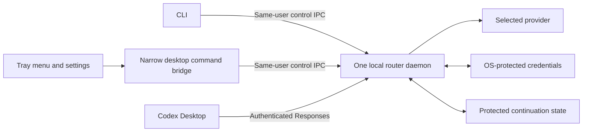

# Runtime, CLI, and desktop control

Status: proposed recommendation. No runtime, dependency, daemon, CLI, tray, or desktop application is installed by this design.

## Recommendation

Use **TypeScript on Node.js for the first integration experiment**, with a standalone router/CLI and an **Electron tray and settings companion** as the leading product combination. Confirm the production stack at the pre-M1 gate below. Rust is the strongest alternative when native CLI distribution and a Rust core outweigh the expected protocol-iteration benefit of TypeScript. The UI framework is a separate choice; a Rust core can still have an Electron companion.

This is an engineering judgment, not a benchmark result. The largest current risks are desktop request semantics, provider continuation, and account ownership. There is no measured throughput, memory, or latency problem that requires a systems language. A reversible experiment-language choice is needed before M0; production support is confirmed afterward. Implement one experiment, not four competing routers.

The user-facing product should eventually provide both interfaces: a CLI for setup, diagnostics, scripting, and recovery, and a small tray/settings app for routine route and account management. Keep the CLI usable without a graphical session. Introduce the desktop companion after the control contract works; it should not delay proof that both API adapters work.

## Language comparison

| Candidate | Strongest reason to choose it | Main cost for this product | Evidence that would change the choice |
| --- | --- | --- | --- |
| TypeScript / Node.js | Direct JSON/event work, one language across CLI/control DTOs and Electron, and convenient provider tooling | Standalone runtime packaging, native credential integration, and Electron maintenance remain real work | Clean-machine CLI packaging, cancellation/backpressure, secret storage, or measured resource budget fails |
| Rust | Compiled core/CLI distribution, explicit protocol state, and a natural Rust backend for Tauri | More initial async/type-system work; direct provider HTTP adapters need ownership | A demonstrated distribution/resource requirement outweighs protocol iteration cost, and the maintainer can sustain Rust changes |
| Python | Clear adapter code, strong provider libraries, short feedback loops, and a Python CLI; Qt is an available one-language UI direction | Frozen application/native dependency packaging; an Electron UI adds another runtime and language | Maintainer fluency and a packaged cross-platform spike show lower total delivery cost than TypeScript |
| Go | A strong standalone daemon/CLI model and straightforward HTTP cancellation primitives | A web companion can add another maintained language/runtime; adapter ergonomics still matter | Headless deployment and operational simplicity dominate, with demonstrably simpler packaging/maintenance |

All four can implement asynchronous HTTP streaming. Do not select by an assumed GIL bottleneck, Rust security guarantee, or unmeasured model-response latency advantage. Protocol correctness depends on state, validation, cancellation, and tests in every language.

Maintainer proficiency and expected change frequency are decision inputs for every candidate, not only Python or Rust. Neither has been measured for this project. Sharing TypeScript types is useful but does not establish that Electron is the best shell or that only one runtime binary will be distributed; a standalone Node daemon and Electron can ship separate runtime copies.

Node supplies `fetch`, abort signals, and Web Streams. Standalone executable packaging exists but needs validation; it is not correct to assume an installed Node runtime is always required or that packaging is already solved. [Node globals](https://nodejs.org/api/globals.html), [Single executable applications](https://nodejs.org/api/single-executable-applications.html)

Rust can consume byte streams directly; Go request contexts cover the HTTP request and response body; Python HTTPX supports asynchronous response streaming. These are transport primitives, not Codex compatibility implementations. Python application bundling must be built and tested for its target environment. [Rust HTTP streaming](https://docs.rs/reqwest/latest/reqwest/struct.Response.html), [Go HTTP](https://pkg.go.dev/net/http), [Python async HTTP](https://www.python-httpx.org/async/), [Python application bundling](https://www.pyinstaller.org/en/stable/operating-mode.html)

Vendor SDKs may reduce request boilerplate, but must not own retries, fallback, tool execution, or hidden conversation state against the router contract. Use native HTTP when needed to preserve exact events and headers. Official library availability is useful evidence, not a requirement to invent an SDK abstraction for every language. [Claude libraries](https://platform.claude.com/docs/en/cli-sdks-libraries/overview), [Gemini libraries](https://ai.google.dev/gemini-api/docs/libraries)

## Desktop options

| Option | Product fit | Tradeoff |
| --- | --- | --- |
| Node core with Electron companion | Leading combination for shared TypeScript control types and a web-based tray/settings interface | Ships and maintains Chromium/Node components; measure packaged size and idle resources |
| Rust core with Tauri companion | Strong alternative with Rust-side integration and a TypeScript frontend | Uses OS WebViews and needs separate rendering/build validation on each OS |
| Rust, Go, or Python core with Electron | Keeps a web UI regardless of router language | Adds a daemon-side language and packaging boundary; keep the IPC contract small |
| Python core with Qt UI | Credible if a Python-oriented implementation is the lowest maintenance choice | Validate Python/native GUI packaging and each platform's tray behavior |
| Node core with Tauri | Possible, with a Node sidecar and Rust UI host | Adds a second runtime/language boundary without an established need at present |

Electron and Tauri both support a tray-oriented interface. Tray availability and activation behavior vary across desktop environments, especially Linux. Provide a normal settings window and CLI when a tray is absent; no essential action should require an invisible tray icon. [Electron tray](https://www.electronjs.org/docs/latest/api/tray), [Tauri system tray](https://v2.tauri.app/learn/system-tray/)

Tauri uses Windows WebView2, macOS WKWebView, and Linux WebKitGTK. Electron supplies its Chromium runtime, with its own update and distribution obligations. Choosing a smaller shell does not by itself prove lower total maintenance or stronger isolation. [Tauri process model](https://v2.tauri.app/concept/process-model/), [Electron process model](https://www.electronjs.org/docs/latest/tutorial/process-model)

## One daemon, two control clients

The daemon alone owns inference, profile state, refresh, binding mutations, and continuation. CLI and companion use the same named control operations; they never maintain separate account defaults or refresh sessions. Start with one core implementation and a small control client. Separate processes here express lifecycle and trust boundaries, not microservices or a general plugin platform.

The companion renderer receives redacted view data and invokes an allowlist of actions. It cannot read saved tokens, execute arbitrary shell commands, call provider APIs, or directly mutate router/configuration files. A newly entered API key may pass transiently through a secure input flow, but is cleared and never persisted in renderer storage or logs. OAuth opens the system browser and returns to the daemon's validated callback.

For Electron, require an isolated, sandboxed renderer with Node integration disabled, a narrow preload bridge, validated IPC senders and arguments, and packaged local UI content. For Tauri, use narrow command/capability permissions and validate arguments in the backend. The framework does not replace the daemon's authorization checks. [Electron security](https://www.electronjs.org/docs/latest/tutorial/security), [Tauri capabilities](https://v2.tauri.app/security/capabilities/)

Use same-user OS IPC with peer/owner checks: a protected Windows named pipe or Unix-domain socket is the candidate. Include a protocol/version handshake and installation identity. Do not reuse the inference token as a general administrative credential. A TCP port that answers is not proof that the expected daemon owns it.

Concurrent CLI/UI actions carry an expected configuration revision. Settings publication also compares current on-disk owned values and follows the ownership/recovery rules in the [overview](README.md#desktop-connection). Conflicts require refreshed state; they do not overwrite desktop/user edits. Offline restore and daemon start acquire the same OS ownership lock, so a daemon cannot republish during recovery. Secrets never appear in command arguments, printed JSON, menu labels, or selection events.

## Control and selection contract

The names below describe planned actions, not executable commands.

| Action | Shared CLI/UI behavior |
| --- | --- |
| Status and list | Show daemon state, available routes, profile readiness, and safe failure categories |
| Add profile | Start isolated authorization or protected API-key input; publish only after validation and persistence |
| Select route for new chats | Select an immutable alias in desktop settings; stage a catalog/restart when needed; never remap existing aliases |
| Reauthorize | Renew the selected managed registration only; reject an identity mismatch |
| Remove profile | Disable new requests, handle active work explicitly, clear local material, and report revocation outcome |
| Recover interrupted turn | Inspect safe lineage/status and perform the explicit recovery described in [Protocol](protocol.md) |
| Restore connection | Restore owned desktop settings; an offline CLI path works with the daemon stopped and exclusive configuration ownership |

Account selection in the tray chooses a complete provider/model/profile route for **new chats**. If several models use that account, require the desired route to be selected; do not introduce a floating alias that changes all existing conversations. Adding an account can require catalog publication and a desktop restart.

Display desired and applied selection separately. Use states such as `Ready`, `Needs sign-in`, `Unavailable`, `Restart Codex to apply`, and `Compatibility update required`. A configuration write or request from an existing chat is not evidence that a new-chat default was adopted. Confirm only through qualified client behavior correlated with the relevant settings generation. If only a verified new conversation is observable, report `Observed on a new chat` rather than global application. Existing chats remain on their original routes. For compatibility mismatch, offer the qualified update or explicit prior-connection restore described in the [catalog contract](README.md#endpoints-and-catalog).

## Tray and process lifecycle

| Action | Behavior |
| --- | --- |
| Start router | Idempotent under an OS ownership lock; connect to a verified existing daemon or start one. Unknown owner/occupied port is an error. |
| Open companion twice | Focus the existing companion; do not create another daemon or refresh owner. |
| Close settings window | Hide the window when a visible tray remains; otherwise preserve a usable launcher/window path. Routing continues. |
| Quit companion | Exit the UI only. Clearly indicate that the router continues and remains controllable by CLI. |
| Stop router | Stop admitting work, drain for a bounded period, then explicitly cancel remaining requests and retain required recovery state. |
| OS shutdown, crash, forced exit | Treat unfinished delivery as interrupted; no automatic inference or tool replay on restart. |
| Start at sign-in | Later opt-in per-user setting with one launcher owner; no elevated service or automatic startup is assumed. |

A packaged update has one lifecycle owner: stop admission, drain/cancel safely, stop the daemon, replace files, then start and verify the matching control protocol before reconnecting the companion. A GUI updater must not replace an independently running daemon behind its back. Initially use explicit updates; automatic updating is a separate implementation decision.

The tray menu should offer status, open settings, select a route for new chats, manage accounts, stop router, and quit companion as distinct actions. Confirm stopping only when it would interrupt active work. Tray status represents router availability and the selected new-chat route, not provider quota guessed from a local health signal.

## Platform targets

All entries below are targets, not verified support. Begin live qualification on the available Windows client while preserving the same architecture for macOS and Linux. A release may claim only its individually qualified platform/architecture combinations.

| Surface | Windows | macOS | Linux |
| --- | --- | --- | --- |
| Core and CLI | Native launch, pipe ownership, supported credential facility | Native launch, socket ownership, Keychain integration | Headless launch, socket ownership, available/unlocked Secret Service or qualified equivalent |
| Companion | Tray, installer, signing, and Electron or WebView2 packaging | Menu-bar behavior, signing/notarization, runtime packaging | Desktop/tray variation, package dependencies, display-session availability |
| Credential recovery | User-context and store-access failures | Locked/denied Keychain access | Missing/locked keyring and absent graphical session |
| Codex Desktop E2E | Exact available Desktop/bundled-client combination | Exact available Desktop/bundled-client combination | Conditional on an available supported client; core portability is not a Desktop-support claim |

Choose and record supported OS versions and CPU architectures when building release artifacts. Validate installers, upgrade/uninstall, Unicode/space-containing paths, environment propagation, sleep/resume, IPC permissions, and crash recovery on each combination. Do not assume cross-compilation proves installation or credential compatibility.

The daemon's secret facility must work independently of Electron/Tauri. GUI-only secret storage cannot be the sole credential owner for the headless CLI. For example, Electron's Linux storage can select an unprotected fallback; that outcome must be rejected under the [credential policy](accounts.md), not silently used. [Electron storage behavior](https://www.electronjs.org/docs/latest/api/safe-storage)

Here, headless means that the daemon/CLI can run without the companion or a display dependency. It does not add remote hosting or promise a client on a machine without Codex Desktop. Inference still requires a qualified local client and usable protected secret store. On an environment without them, diagnostics and offline configuration recovery remain useful; do not claim a Linux Desktop integration merely because the binary launches.

## Adoption gates

Use a maintained Node release for the bounded M0 experiment; choose its exact version when implementation starts. Exercise fragmented SSE, cancellation, tool loops, and continuation across restart. Before M1, record an explicit production-runtime decision backed by small native-boundary probes on each intended release platform:

- A clean-machine CLI-only package can write/read protected secrets, recover from a locked/missing store, and restore protected state without Electron/Tauri. Include any native-addon loading/extraction required by the chosen package format.
- Windows pipe ownership, ACL enforcement and first-instance behavior prevent adopting an unrelated server. On Unix, verify socket-directory permissions and the selected peer-authentication mechanism rather than assuming the HTTP stack supplies them.
- Daemon/start/offline-restore ownership, cancellation, and bounded streaming work in the packaged process.

Record packaging size, idle memory/CPU, startup, and sustained-stream memory before resource-based choices. A companion-specific packaging/tray probe belongs before companion implementation, not as an unexplained prerequisite for a CLI-only router. Unavailable platform validation stays explicitly pending and limits what a release can claim.

If Node fails a concrete requirement, isolate the failure before switching languages. Compare a small Rust, Python, or Go probe only for the failed boundary, with the same acceptance case. No automatic rewrite, second production backend, generic transport abstraction, or permanent mixed-runtime architecture is implied.

The companion is part of the product direction and can follow the working CLI/control contract. Its initial purpose is accounts, route selection, status, and recovery. It is not a second chat client, transcript viewer, or replacement Codex Desktop.
