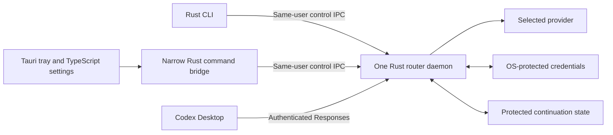

# Runtime, CLI, and desktop control

Status: selected implementation direction, subject to qualification. No runtime, dependency, daemon, CLI, tray, or desktop application is installed by this design.

## Stack decision

Select **Rust for the standalone daemon and CLI**, and **Tauri 2 with a TypeScript frontend for the tray/settings companion**. Use Rust for the bounded M0 integration slice as well. The companion follows the working core/control contract and does not own inference or credentials. This is the default implementation decision; qualification can stop delivery or reopen a specific boundary under the conditions below.

The deciding requirements are a GUI-independent daemon, protected secrets and continuation, authenticated native IPC, process ownership, and coordinated packaging. They give native integration substantial weight even without a performance bottleneck. Rust keeps those responsibilities and the companion host in one native language; the small settings UI does not yet justify a bundled Chromium runtime. Direct HTTP adapters also reduce the importance of any language's provider SDK ecosystem.

Development assumes AI-assisted implementation, so language familiarity has less weight than supported behavior, dependency quality, native integration, and distribution. This is an engineering judgment at moderate confidence, not a benchmark or proof of faster delivery. Async Rust still requires review and debugging. The largest feasibility risks remain desktop request semantics, provider continuation, and authentication; choosing Rust resolves none of them. Implement one bounded Rust slice, without a planned disposable Node core and later rewrite.

The user-facing product should eventually provide both interfaces: a CLI for setup, diagnostics, scripting, and recovery, and a small tray/settings app for routine route and account management. Keep the CLI usable without a graphical session. Introduce the desktop companion after the control contract works; it should not delay proof that both API adapters work.

## Language comparison

| Candidate | Strongest reason to choose it | Main cost for this product | Evidence that would change the choice |
| --- | --- | --- | --- |
| Rust | Native core/CLI distribution and direct access to required OS boundaries; shares the Tauri host language | Async ownership, native integration, and provider-schema changes still require maintenance | Selected; reconsider a demonstrated core-specific feature, integration, distribution, or maintenance blocker with a qualified alternative |
| TypeScript / Node.js | Direct JSON/event work, fast protocol iteration, and shared control/UI types with Electron | A standalone daemon still needs native credentials/IPC and runtime/native-addon packaging; Electron has its own runtime | Strongest core alternative if its maintained libraries solve a concrete blocker under the same acceptance cases |
| Python | Clear adapters and CLI; asyncio/HTTPX plus PySide6 can keep application logic in one language | Frozen interpreter/native-library packaging and OS integration remain; Electron adds another application language/runtime | A concrete library or operational advantage plus equivalent packaged native-boundary checks |
| Go | Standalone daemon/CLI and straightforward HTTP cancellation primitives | OS integration still needs ownership; a Tauri/Electron companion adds another language boundary | Concrete operational advantage, not a presumed dependency-free build |

All four can implement asynchronous HTTP streaming. Do not select by an assumed GIL bottleneck, Rust security guarantee, or unmeasured model-response latency advantage. Protocol correctness depends on state, validation, cancellation, and tests in every language.

AI-assisted development does not establish library support or packaged behavior. Compare actual implementation failures and dependency maintenance rather than presumed language-learning speed. Shared TypeScript types still require runtime boundary validation, and a standalone Node daemon and Electron have separate runtime/lifecycle responsibilities. Windows-first qualification reduces initial work for every candidate, not only Node.

Node supplies `fetch`, abort signals, and Web Streams. Standalone executable packaging exists but needs validation; it is not correct to assume an installed Node runtime is always required or that packaging is already solved. [Node globals](https://nodejs.org/api/globals.html), [Single executable applications](https://nodejs.org/api/single-executable-applications.html)

Rust can consume byte streams directly; Go request contexts cover the HTTP request and response body; Python HTTPX supports asynchronous response streaming. These are transport primitives, not Codex compatibility implementations. Python application bundling must be built and tested for its target environment. [Rust HTTP streaming](https://docs.rs/reqwest/latest/reqwest/struct.Response.html), [Go HTTP](https://pkg.go.dev/net/http), [Python async HTTP](https://www.python-httpx.org/async/), [Python application bundling](https://www.pyinstaller.org/en/stable/operating-mode.html)

Vendor SDKs may reduce request boilerplate, but must not own retries, fallback, tool execution, or hidden conversation state against the router contract. Use native HTTP when needed to preserve exact events and headers. Official library availability is useful evidence, not a requirement to invent an SDK abstraction for every language. [Claude libraries](https://platform.claude.com/docs/en/cli-sdks-libraries/overview), [Gemini libraries](https://ai.google.dev/gemini-api/docs/libraries)

Python's strongest comparison is a separate asyncio daemon with a PySide6 control UI. Keep its GUI event loop out of routing. Qt local sockets still need platform-specific ownership checks; their permission options alone do not provide the required macOS/Windows guarantees. [Qt local server behavior](https://doc.qt.io/qt-6/qlocalserver.html)

## Implementation elements

These are selected component directions, not installed dependencies or a fixed version manifest. Pin maintained versions and verify their actual behavior when implementation begins.

| Element | Rust/Tauri direction | Required implementation work |
| --- | --- | --- |
| Core and CLI | One Rust package with library modules and a daemon/CLI binary | CLI actions use the control protocol; ordinary CLI invocation must not create a second inference owner |
| HTTP and SSE | Tokio, Axum ingress, reqwest upstream, serde/serde_json | Incremental UTF-8/SSE decoding, bounded tool assembly, exact terminal states, native passthrough versus provider translation |
| Cancellation and load | Tracked async tasks, request cancellation, bounded channels | Bound bytes as well as item counts; close upstream work on disconnect; keep blocking native operations off the async executor |
| Continuation | Explicit lineage/state transitions and provider-native opaque values | Preserve opaque fields; admission reservation, acknowledgment, authenticated persistence and crash recovery |
| Secrets | Daemon-owned, deliberately selected OS credential adapters | GUI-independent key access and locked/missing-store recovery; follow [Accounts](accounts.md#persistence-and-recovery) |
| Control IPC | Windows named pipes; private Unix sockets | Explicit Windows ACL, first-instance and remote-client rejection; peer/server ownership checks on each OS |
| Configuration and launch | Daemon-owned publication and Codex launch operations | Compare owned settings, preserve external edits, deliver the local token only to the intended client, recover interrupted installation |
| Companion | Tauri Rust host and local TypeScript settings/tray frontend | Narrow commands using the same control operations; no provider HTTP, saved secrets, or independent state writer in the UI |
| Distribution | CLI-only artifact plus a companion package carrying matching executables | Per-target builds, native dependencies, signing, controlled install paths and one update owner |

Start with modules for the existing responsibilities. Add a Tauri application package when companion work starts; share only the control contracts/client needed by both callers. Split crates only for demonstrated reuse or dependency isolation. The CLI-only build must contain no Tauri/WebView dependency. A generic provider platform, several production backends, or a public plugin system is unnecessary.

Axum SSE and reqwest byte streams are transport primitives; adapter semantics remain application code. Tokio exposes Windows pipe security attributes/first-instance options and Unix peer credentials, but correct use still needs native code and qualification. Node can satisfy the same boundary with suitable native integration; ordinary IPC options alone are not proof of peer ownership. [Axum SSE](https://docs.rs/axum/latest/axum/response/sse/index.html), [Tokio pipe options](https://docs.rs/tokio/latest/tokio/net/windows/named_pipe/struct.ServerOptions.html), [Unix peer credentials](https://docs.rs/tokio/latest/tokio/net/struct.UnixStream.html#method.peer_cred), [Node IPC](https://nodejs.org/api/net.html#ipc-support)

Configure HTTP policy explicitly: no inference retries or redirects, bounded connect/idle/total lifetimes, and fixed provider destinations. Current reqwest defaults include protocol-NACK retries, redirect following, and system-proxy discovery; they do not implement this policy. Qualify proxy selection and TLS trust, including required enterprise CA/proxy behavior, without disabling certificate verification. Local control and loopback traffic must not use an upstream proxy. Bound decoded event and tool bytes even when decompression is enabled. On the server, independently configure and test header count/bytes, body/decoded-body limits, read deadlines, idle connections and active requests; do not rely on extractor-specific defaults. [HTTP client policy](https://docs.rs/reqwest/latest/reqwest/struct.ClientBuilder.html)

### Support boundaries

Static documentation review has identified implementation paths for the required runtime elements, with no demonstrated Rust/Tauri feature blocker. That is not verified product support.

| Boundary | Available path or known limit | Consequence |
| --- | --- | --- |
| Streaming and provider state | Rust HTTP/SSE/JSON primitives exist | Tool semantics, signed-state replay and cancellation still require actual client/provider evidence |
| Native credentials and IPC | OS APIs and Rust integrations exist | Qualify private permissions, ownership, store availability and recovery in the packaged process |
| Linux tray behavior | Tauri does not support tray mouse events on Linux; a desktop may lack a usable tray | Use menu actions plus settings window/CLI; no essential action may depend on icon click or hover |
| Headless credentials and WebViews | Protected-store sessions and companion WebViews are environment prerequisites | Missing protected storage blocks inference; CLI-only packaging must not depend on a WebView |
| Codex integration | Model selection, authentication, identity/acknowledgment and compaction remain unverified | A client-side gate failure requires integration revision; a different language is not an assumed remedy |
| Inference listener trust | Secure administrative IPC does not authenticate the separate TCP listener to Codex | Preserve the server-authentication/shared-machine gate in [Accounts](accounts.md#local-security-boundaries) |

The Linux tray limit has a defined product fallback; it is not an unsupported account-management feature. [Tauri tray behavior](https://v2.tauri.app/learn/system-tray/)

## Desktop options

| Option | Product fit | Tradeoff |
| --- | --- | --- |
| Rust core with Tauri companion | Selected for a native core/host and a small TypeScript control UI | Uses OS WebViews and needs separate rendering/build validation on each OS |
| Node core with Electron companion | Strong alternative for TypeScript ownership and consistent Chromium rendering | Ships Chromium/Node components plus the daemon's native integration |
| Rust, Go, or Python core with Electron | Keeps a web UI regardless of router language | Adds a daemon-side language and packaging boundary; keep the IPC contract small |
| Python core with Qt UI | Credible if a Python-oriented implementation is the lowest maintenance choice | Validate Python/native GUI packaging and each platform's tray behavior |
| Node core with Tauri | Possible, with a Node sidecar and Rust UI host | Adds a second runtime/language boundary without an established need at present |

Electron and Tauri both support a tray-oriented interface. Tray availability and activation behavior vary across desktop environments, especially Linux. Provide a normal settings window and CLI when a tray is absent; no essential action should require an invisible tray icon. [Electron tray](https://www.electronjs.org/docs/latest/api/tray), [Tauri system tray](https://v2.tauri.app/learn/system-tray/)

Tauri uses Windows WebView2, macOS WKWebView, and Linux WebKitGTK. Electron supplies its Chromium runtime, with its own update and distribution obligations. Choosing a smaller shell does not by itself prove lower total maintenance or stronger isolation. [Tauri process model](https://v2.tauri.app/concept/process-model/), [Electron process model](https://www.electronjs.org/docs/latest/tutorial/process-model)

Package the Rust executable with the companion as a target-specific external binary when useful, while keeping a separate CLI-only distribution. Tauri sidecar packaging does not define independent daemon lifetime, authentication, ownership, or update safety. The host must use the same verified start/adopt operation as the CLI; quitting or crashing the companion must leave an independently owned daemon available. Do not assume a shell-spawned child satisfies that contract. [External binaries](https://v2.tauri.app/develop/sidecar/)

## One daemon, two control clients

The daemon alone owns inference, profile state, refresh, binding mutations, and continuation. CLI and companion use the same named control operations; they never maintain separate account defaults or refresh sessions. Start with one core implementation and a small control client. Separate processes here express lifecycle and trust boundaries, not microservices or a general plugin platform.

One shared Rust bootstrap implementation serves CLI start, the companion host, and the launcher shortcut. Serialize start/adopt and offline restore, verify an existing daemon, or start the executable with an OS-qualified independent lifetime and controlled environment/handle inheritance. Publish readiness only after the daemon holds its own lifetime ownership and authenticated control endpoint. Concurrent callers adopt that verified instance. The companion's child-management or exit cleanup must not terminate it; detachment must be tested rather than inferred from a sidecar API. Failed startup releases ownership without publishing a usable endpoint.

The companion renderer receives redacted view data and invokes an allowlist of actions. It cannot read saved tokens, execute arbitrary shell commands, call provider APIs, or directly mutate router/configuration files. A newly entered API key may pass transiently through a secure input flow, but is cleared and never persisted in renderer storage or logs. OAuth opens the system browser and returns to the daemon's validated callback.

For Electron, require an isolated, sandboxed renderer with Node integration disabled, a narrow preload bridge, validated IPC senders and arguments, and packaged local UI content. For Tauri, use narrow command/capability permissions and validate arguments in the backend. Rust/TypeScript view-data contracts add synchronization work: version the small DTO surface and validate both sides; generated types alone do not validate received data. The framework does not replace the daemon's authorization checks. [Electron security](https://www.electronjs.org/docs/latest/tutorial/security), [Tauri capabilities](https://v2.tauri.app/security/capabilities/)

Use same-user OS IPC with peer/owner checks: a protected Windows named pipe or Unix-domain socket is the candidate. Include a protocol/version handshake and installation identity. Do not reuse the inference token as a general administrative credential. A TCP port that answers is not proof that the expected daemon owns it.

Tokio's transport/security options are not a complete peer-identity implementation. Supply the remaining OS identity checks through reviewed native bindings where needed, especially Windows security descriptors and peer/server identity. A PID alone is not authentication or permission to terminate a process; use the verified OS identity and process-lifetime evidence appropriate to that operation.

Concurrent CLI/UI actions carry an expected configuration revision. Settings publication also compares current on-disk owned values and follows the ownership/recovery rules in the [overview](README.md#desktop-connection). Conflicts require refreshed state; they do not overwrite desktop/user edits. Offline restore and daemon start acquire the same OS ownership lock, so a daemon cannot republish during recovery. Secrets never appear in command arguments, printed JSON, menu labels, or selection events.

A hung daemon requires an explicit stop/recovery action before offline restore. Verify process identity and ownership, including protection against PID reuse, before terminating it; acquire the OS lock only after verified exit. Never steal a live lock or terminate an unrelated listener. If ownership cannot be established, report the blocked recovery and leave settings intact.

## Control and selection contract

The names below describe planned actions, not executable commands.

| Action | Shared CLI/UI behavior |
| --- | --- |
| Status and list | Show daemon state, available routes, profile readiness, and safe failure categories |
| Launch Codex Desktop | Ask the daemon to launch the verified client with protected token delivery; coordinate a restart for an existing incompatible process |
| Add profile | Start isolated authorization or protected API-key input; publish only after validation and persistence |
| Select route for new chats | Select an immutable alias in desktop settings; stage a catalog/restart when needed; never remap existing aliases |
| Reauthorize | Renew the selected managed registration only; reject an identity mismatch |
| Remove profile | Disable new requests, handle active work explicitly, clear local material, and report revocation outcome |
| Recover interrupted turn | Inspect safe lineage/status and perform the explicit recovery described in [Protocol](protocol.md) |
| Restore connection | Restore owned desktop settings; an offline CLI path works with the daemon stopped and exclusive configuration ownership |

Account selection in the tray chooses a complete provider/model/profile route for **new chats**. If several models use that account, require the desired route to be selected; do not introduce a floating alias that changes all existing conversations. Adding an account can require catalog publication and a desktop restart.

Display desired and applied selection separately. Use states such as `Ready`, `Needs sign-in`, `Unavailable`, `Restart Codex to apply`, and `Compatibility update required`. A configuration write or request from an existing chat is not evidence that a new-chat default was adopted. Confirm only through qualified client behavior correlated with the relevant settings generation. If only a verified new conversation is observable, report `Observed on a new chat` rather than global application. Existing chats remain on their original routes. For compatibility mismatch, offer the qualified update or explicit prior-connection restore described in the [catalog contract](README.md#endpoints-and-catalog).

## Tray and process lifecycle

| Action | Behavior |
| --- | --- |
| Start router | Idempotent under an OS ownership lock; connect to a verified existing daemon or start one. Unknown owner/occupied port is an error. |
| Open companion twice | Focus the existing companion; do not create another daemon or refresh owner. |
| Close settings window | Hide only when a usable tray is established; treat unknown tray availability as absent and preserve a normal window/launcher path. Routing continues. |
| Quit companion | Exit the UI only. Clearly indicate that the router continues and remains controllable by CLI. |
| Stop router | Stop admitting work, drain for a bounded period, then explicitly cancel remaining requests and retain required recovery state. |
| OS shutdown, crash, forced exit | Treat unfinished delivery as interrupted; no automatic inference or tool replay on restart. |
| Start at sign-in | Later opt-in per-user setting with one launcher owner; no elevated service or automatic startup is assumed. |

A packaged update has one lifecycle owner: stop admission, drain/cancel safely, stop the daemon, replace files, then start and verify the matching control protocol before reconnecting the companion. A GUI updater must not replace an independently running daemon behind its back. Initially use explicit updates; automatic updating is a separate implementation decision.

The tray menu should offer status, open settings, select a route for new chats, manage accounts, stop router, and quit companion as distinct actions. Confirm stopping only when it would interrupt active work. Tray status represents router availability and the selected new-chat route, not provider quota guessed from a local health signal.

## Platform targets

All entries below are targets, not verified support. Begin live qualification on the available Windows client while preserving the same architecture for macOS and Linux. A release may claim only its individually qualified platform/architecture combinations.

| Surface | Windows | macOS | Linux |
| --- | --- | --- | --- |
| Core and CLI | Native launch, pipe ownership, supported credential facility | Native launch, socket ownership, Keychain integration | Headless launch, socket ownership, available/unlocked Secret Service or qualified equivalent |
| Companion | Tray, installer/signing, WebView2 availability | Menu-bar behavior, signing/notarization, system WKWebView | Desktop/tray variation, WebKitGTK/package dependencies, display-session availability |
| Credential recovery | User-context and store-access failures | Locked/denied Keychain access | Missing/locked keyring and absent graphical session |
| Codex Desktop E2E | Exact available Desktop/bundled-client combination | Exact available Desktop/bundled-client combination | Conditional on an available supported client; core portability is not a Desktop-support claim |

Choose and record supported OS versions and CPU architectures when building release artifacts. Validate installers, upgrade/uninstall, Unicode/space-containing paths, environment propagation, sleep/resume, IPC permissions, and crash recovery on each combination. Do not assume cross-compilation proves installation or credential compatibility.

Tauri's system WebViews create a different dependency/testing cost from Electron's bundled engine. Verify required rendering, accessibility, tray/menu actions, and installation on supported machines; provide the window/CLI alternative when tray events are unavailable. A Windows-qualified release need not wait for other OS targets, but must label them pending. [WebView versions](https://v2.tauri.app/reference/webview-versions/), [Platform prerequisites](https://v2.tauri.app/start/prerequisites/)

The daemon's secret facility must work independently of Electron/Tauri. GUI-only secret storage cannot be the sole credential owner for the headless CLI. For example, Electron's Linux storage can select an unprotected fallback; that outcome must be rejected under the [credential policy](accounts.md), not silently used. [Electron storage behavior](https://www.electronjs.org/docs/latest/api/safe-storage)

Here, headless means that the daemon/CLI can run without the companion or a display dependency. It does not add remote hosting or promise a client on a machine without Codex Desktop. Inference still requires a qualified local client and usable protected secret store. On an environment without them, diagnostics and offline configuration recovery remain useful; do not claim a Linux Desktop integration merely because the binary launches.

## Qualification and reconsideration

Use a maintained Rust toolchain for M0; choose its exact version and dependencies when implementation starts. Exercise fragmented SSE, cancellation, representative tool loops, and continuation across restart. Before M1, qualify the chosen runtime and packaging with small native-boundary probes on each intended release platform:

- A clean-machine CLI-only package can write/read protected secrets, recover from a locked/missing store, and restore protected state across process restart and OS reboot without a GUI runtime. Include native-library and TLS trust dependencies of the actual package.
- Windows pipe ownership, ACL enforcement and first-instance behavior prevent adopting an unrelated server. On Unix, verify socket-directory permissions and the selected peer-authentication mechanism rather than assuming the HTTP stack supplies them.
- Concurrent bootstrap callers create/adopt one verified daemon; caller exit does not kill it. Daemon/start/offline-restore ownership, cancellation, and bounded streaming work in the packaged process.
- Explicit retry/redirect/proxy policies and byte limits remain effective through the selected HTTP stack; blocking OS calls cannot stall unrelated streams.

Record packaging size, idle memory/CPU, startup, and sustained-stream memory before resource-based choices. A companion-specific packaging/tray probe belongs before companion implementation, not as an unexplained prerequisite for a CLI-only router. Unavailable platform validation stays explicitly pending and limits what a release can claim.

Reopen the Rust decision for a demonstrated core-specific feature, native integration, distribution, or disproportionate maintenance blocker with a concrete alternative solution. Node/TypeScript is the first core alternative; Python requires a concrete library or operational advantage. An alternative must satisfy the same packaged secrets, IPC, lifecycle, and continuation cases. Language familiarity alone is not the deciding criterion under the AI-assisted development assumption. Do not build competing full implementations to manufacture a comparison.

Reopen Tauri independently if a required UI/accessibility flow or supported-machine package fails and a bounded Electron probe provides a maintainable solution. Retain the Rust daemon in that case. A Codex authentication or conversation-identity gate failure does not justify a language rewrite unless the cause is implementation-specific. Exact physical storage, crypto library, dependency versions and resource budgets remain implementation decisions; none requires another production core.

The companion is part of the product direction and can follow the working CLI/control contract. Its initial purpose is accounts, route selection, status, and recovery. It is not a second chat client, transcript viewer, or replacement Codex Desktop.
